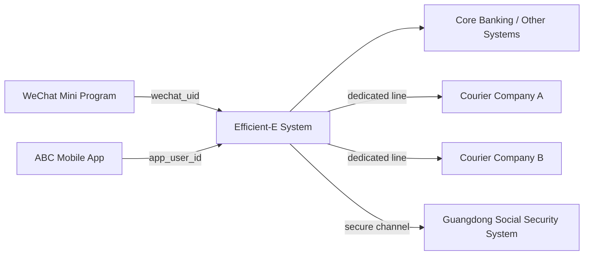
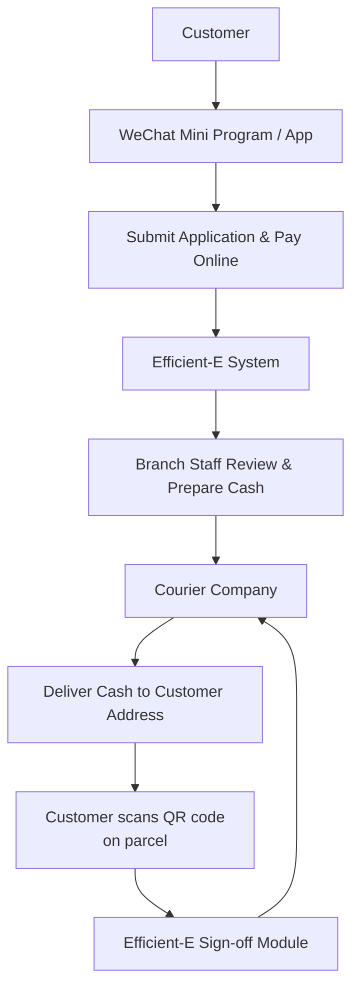

# Efficient - E Process Service

## Project Overview

Efficient - E Process Service (**快E达**) is an end‑to‑end service platform built for **Agricultural Bank of China, Shenzhen Branch** to handle **online application and physical item delivery** for branch services.  
Due to confidentiality requirements, only high‑level business flows and architecture are described here, without exposing sensitive implementation details.

Typical scenarios include:

- Customers applying for **cash pickup** (e.g. red envelopes for New Year)
- Applying for **social security cards** for family members
- Requesting **printed account statements / bills**

Instead of queueing at a branch on workdays, customers can submit applications online and receive items by delivery, while branch staff process and prepare the items in the background.

The platform consists of:

- A responsive **frontend website** for customer and staff operations  
- A **backend service layer** exposing RESTful APIs for core banking workflows  
- An **admin management portal** for product configuration, approval flows, batch operations, and monitoring

In this project, my role was **Assistant Product Developer**, working as a bridge between business teams and the technical team while also implementing core backend features.

### Example Business Flow – Cash Delivery

The following simple flow illustrates how a customer books new banknotes and receives them at home:

## Technical Architecture

**Tech Stack**: Spring Boot, Vue, jQuery, MyBatis with Oracle database, FastDFS for image management, RSA+AES encryption, Redis session storage, SMS verification, third‑party logistics APIs.

-- **Frontend Layer**
  - **Customer side (Vue)**: customers access Vue pages via deep links from the **mobile banking app** and the **Shenzhen Branch WeChat mini‑program**
  - Each entry point reuses its own user system; the platform receives user identity info via URL parameters / headers and performs permission checks accordingly
  - Customers choose services (cash pickup, social security card, statement printing), fill in personal info, upload **ID photos**, specify **delivery address**, and **pay the cash amount online in advance** for cash‑delivery orders
  - **Management side (jQuery)**: jQuery-based internal management portal embedded in the Spring Boot app, only accessible from bank intranet PCs and integrated with the bank’s internal staff identity system; staff review submitted information and prepare corresponding items

- **Service Layer**
  - Spring Boot services exposing REST APIs for customer applications, approval workflows, and item delivery orchestration
  - MyBatis with Oracle for transactional data access
  - Redis-based session storage and SMS verification integration with the bank’s SMS gateway
- **File & Media**
  - FastDFS for document and image storage (e.g., uploaded ID card photos and other application attachments)
  - Encrypted file links shared across internal subsystems
- **Security & Delivery Integration**
  - RSA + AES hybrid encryption to protect sensitive payloads
  - Role-based access control aligned with bank roles (tellers, product managers, approvers)
  - Integration with **two external delivery company APIs**: automatically creates delivery orders after staff confirmation, tracks delivery status, and ensures items (cash, cards, documents) are sent to the customer’s address

## Key Responsibilities & Achievements

- **System Ownership & Operations**
  - Acted as system owner for 快E达 in the branch, coordinating with infrastructure, security, and business teams  
  - Performed daily operations, monitoring scheduled jobs, and handling incident analysis and follow-up

- **Service Development & Maintenance**
  - Independently developed several backend services for customer application flows and internal review steps  
  - Implemented data models and MyBatis mappers for new products and optimized slow SQL queries
  - Added Redis-based session management and optimized login/session stability under peak loads

- **Process & Product Support**
  - Participated in requirements clarification with product managers and branch business teams  
  - Designed detailed function specifications and edge‑case handling for new process nodes
  - Supported UAT, prepared test cases, and assisted branches in acceptance testing

- **Documentation & Knowledge Sharing**
  - Authored **project definition and design documents**, including sequence diagrams and data flow descriptions  
  - Maintained runbooks and troubleshooting guides for common production issues

## What I Learned

- How to design and maintain **multi-step approval flows** in a large stateful system
- Practical experience integrating **Spring Boot + MyBatis + Oracle** in a highly regulated banking environment
- Applying **encryption, session management, and access control** to meet financial‑grade security requirements
- Balancing business expectations, risk control, and technical feasibility when iterating on production systems

*This project represents a company internal system, with business logic and technical details appropriately simplified for this portfolio.*

