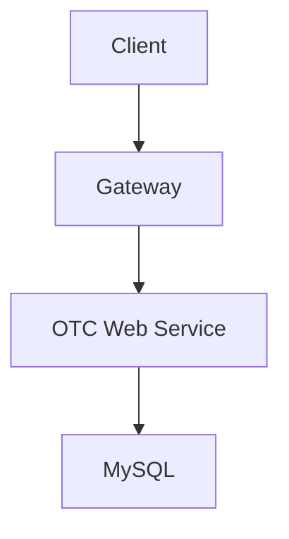

# OTC Trading Platform: Building Multi-Tenant Microservices Architecture

## Project Overview

An **OTC (Over-The-Counter) trading platform** built with microservices architecture, enabling peer-to-peer digital asset transactions between users. The system implements an escrow trading model with fund freezing, dispute arbitration, and real-time chat features to ensure transaction security. It supports flexible configurations for multiple cryptocurrencies, fiat currencies, and multi-tenancy.

**Core Business Scenarios:**

- Users publish buy/sell advertisements with custom pricing and trading limits
- Order matching and fund escrow to ensure transaction security
- Real-time chat communication to enhance trading experience
- Merchant certification and management to establish trust

## Technical Architecture

### Microservices Architecture

The system adopts **Spring Cloud** microservices architecture with multiple service modules:

- **OTC Web Service**: User-facing C2C trading business APIs
- **OTC Admin Service**: Operations management, dispute arbitration, data statistics
- **OTC Chat Service**: Real-time chat and message push
- **OTC Common Module**: Shared business logic and data access layer

### Technology Stack

**Backend Framework**

- Spring Boot 3.5.6 (Java SE 21)
- Spring Cloud 2025.0.0 with Spring Cloud Alibaba 2023.0.3.4

**Service Discovery & Configuration**

- Nacos for service discovery and centralized configuration management
- Spring Cloud Bootstrap for loading configuration files
- Dynamic configuration refresh without service restart
- Environment-specific configuration files (dev/prod) in Nacos

**Service Communication**

- Spring Cloud OpenFeign for declarative REST client
- Spring Cloud LoadBalancer for client-side load balancing (replacing Ribbon)
- Custom Feign configuration with request/response interceptors
- Service-to-service communication using service names instead of hardcoded URLs

**Data Persistence**

- MyBatis-Flex with auto-table generation for admin modules
- MyBatis-Plus for ORM operations in business modules
- MySQL 8.0 with HikariCP connection pooling
- Custom Mapper XML with complex JOIN queries for data aggregation
- Transaction management with `@Transactional` annotations

**Caching Strategy**

- **Redis** for distributed caching (user session storage, user ID mapping cache)
- **Caffeine** for local in-memory caching with `@Cacheable` and `@CacheEvict` annotations
- Cache key pattern: `{cacheName}_{tenantId}_{uid}` for multi-tenant data isolation
- Cache-aside pattern: application checks cache first, then database
- Cache invalidation on data updates to ensure consistency

**Message Queue**

- RabbitMQ with fanout exchange pattern for event broadcasting
- Asynchronous message processing for advert lifecycle events
- Idempotent message handling with Redis-based deduplication using message serial numbers
- Transaction synchronization for reliable message delivery after database commits

**File Storage**

- AWS S3 for object storage (migrated from local file system)
- S3 SDK integration with automatic file suffix detection
- Tenant-isolated storage paths for multi-tenancy support
- Configuration-driven storage mode (local/S3) for gradual migration

**Security & Authentication**

- Spring Security for authentication and authorization
- ThreadLocal-based user context storage for request-scoped user information
- HTTP header-based user information passing from gateway
- Role-based access control with tenant isolation

**Other Technologies**

- Spring WebSocket for real-time bidirectional communication
- XXL-JOB for distributed scheduled tasks (exchange rate updates)
- Spring AOP for cross-cutting concerns (logging, transaction management)
- Spring Cache abstraction for unified caching API

## Core Development Work

### 1. Multi-Tenant Architecture Design & Implementation

**Background**: The original system had only one admin backend, unable to meet the differentiated needs of different tenants (company super admins vs. regular tenant users).

**Architecture Design**

**Service Separation**

- Created dedicated tenant backend module separate from company admin module
- Both modules share the same business service layer for code reuse
- Independent deployment and scaling capabilities for each module

**Tenant Isolation Mechanism**

**ThreadLocal-Based Context Management:**

- Implemented tenant context extraction from ThreadLocal storage
- Super admin identification: users with null `tenantId` are treated as super admins
- Current tenant ID retrieval through utility methods for consistent access

**Centralized Tenant Validation:**

- Created unified utility class for tenant ID validation and auto-filling
- Validation logic: checks current user's `tenantId`, rejects super admin access for tenant-only operations
- Auto-fill mechanism: automatically populates missing `tenantId` with current user's `tenantId`
- Tenant ID matching validation: ensures request `tenantId` matches current user's `tenantId`

**Controller-Level Enforcement:**

- Applied tenant validation at controller entry points before business logic execution
- Made dictionary APIs read-only for tenants, removed CRUD operations
- Restricted tenant controller to current tenant info only, disabled cross-tenant management
- All tenant-facing endpoints require tenant validation

**Database Layer Isolation:**

- All business tables include `tenant_id` column for row-level data filtering
- Query builders automatically inject `WHERE tenant_id = ?` conditions
- Composite unique constraints on `(biz_uid, tenant_id)` for user mapping tables
- Database-level data isolation ensures tenant data separation

**Configuration Management:**

- Separate Nacos configuration files for each module (admin vs tenant)
- Environment-specific configuration with profile-based file naming
- Tenant-specific application properties for module customization

### 2. File Storage Migration to AWS S3

**Background**: Original system used local file storage, which had single point of failure and scalability issues.

**Migration Strategy**

**S3 Integration Design**

- Integrated AWS S3 Java SDK for object storage operations
- Implemented upload, download, and delete operations with error handling
- Automatic file suffix detection based on MIME type or file extension
- Tenant-isolated storage path structure for multi-tenancy support

**Path Design**

- Hierarchical path structure: `{tenantId}/{module}/{timestamp}_{suffix}`
- Ensures unique file paths and prevents naming conflicts
- Enables easy tenant-level file management and cleanup

**Configuration-Driven Approach**

- Configuration property for storage mode selection (local/S3)
- Backward compatibility maintained during migration period
- Gradual migration strategy: new uploads to S3, existing files remain accessible
- S3 credentials and bucket configuration externalized to configuration files

**Error Handling & Fallback**

- Exception handling for S3 operation failures
- Retry mechanism for transient failures
- Logging for audit trail and troubleshooting

### 3. Database Performance Optimization

**Background**: Some controllers had N+1 query problems, executing database queries inside loops, causing performance degradation.

**Optimization Strategy**

**N+1 Problem Resolution**

- Identified controllers with loop-based database queries
- Replaced individual queries in loops with batch queries
- Reduced multiple database round trips to single batch operations

**Query Optimization**

- Used MyBatis-Plus batch query methods for efficient data retrieval
- Pre-fetched related data in Service layer before controller processing
- Eliminated redundant database calls through data preprocessing

**Code Refactoring**

- Extracted query logic from controllers to service layer
- Implemented data aggregation methods to reduce database interactions
- Improved code maintainability and testability

### 4. Cache Consistency Fix

**Background**: User company approval workflow had cache inconsistency issues, causing frontend to display stale data after status updates.

**Problem Analysis**

**Cache Key Mismatch**

- Identified inconsistency between `@Cacheable` and `@CacheEvict` key generation
- Original cache key used only `uid`, but needed `tenantId + '_' + uid` for multi-tenant isolation
- Mismatch caused cache eviction to miss the actual cached entries

**Solution Implementation**

**Unified Cache Key Strategy**

- Standardized cache key pattern: `{tenantId}_{uid}` for all cache operations
- Updated `@CacheEvict` annotations to use the same key generation as `@Cacheable`
- Ensured cache write and eviction use identical key generation logic

**Unconditional Cache Invalidation**

- Changed cache eviction from conditional (only on successful updates) to unconditional
- Cache cleared whenever status update is attempted, regardless of affected rows
- Prevents stale cache when duplicate status change requests occur

**Code Refactoring**

- Extracted common cache eviction logic into reusable methods
- Reduced code duplication across multiple status update methods
- Improved maintainability and consistency of cache management

**Cache Management Pattern**

- Cache-aside pattern with manual cache invalidation on updates
- Direct cache manipulation through CacheManager for complex scenarios
- Tenant-aware cache key generation ensures multi-tenant data isolation

### 5. Business Logic Enhancement

**Background**: Advertisement publishing workflow had validation logic flaws in minimum trade amount checking, potentially allowing business rule bypass.

**Validation Logic Fix**

**Minimum Trade Calculation**

- Fixed calculation of remaining tradable value using correct volume and price
- Used `BigDecimal` for precise decimal arithmetic to avoid floating-point precision issues
- Implemented proper rounding strategies with `BigDecimalUtils` utility class

**Null Safety & Boundary Conditions**

- Added null checks for sell volume to handle initial advertisement creation
- Validated that new volume is not less than already sold volume
- Ensured remaining value calculation uses request volume instead of stale database values

**Price Rate Calculation**

- Corrected price rate calculation formula: `(price / marketRate)` with proper rounding
- Multiple rounding steps to ensure precision and consistency
- Used currency-specific accuracy settings for final value formatting

**Optional Field Update Logic**

- Changed update logic from `StringUtils.isNotBlank()` to null-aware updates
- Allows explicit field clearing by accepting empty strings
- Distinguishes between "not updating" (null/omitted) and "clearing field" (empty string)

**Validation Strategy**

- Multi-level validation: request validation, business rule validation, database constraint validation
- Used Spring's `Assert` utilities for clean validation error messages
- Comprehensive error messages guide users to correct input

## Technical Challenges & Solutions

### Multi-Tenant Data Isolation

Ensuring proper data isolation in multi-tenant environments is fundamental to system security. By designing unified validation mechanisms and utility classes, we not only solved current issues but also established a solid foundation for future extensions.

**Design Principles:**

- Defense in depth: validation at multiple layers (controller, service, database)
- Fail-secure: reject operations when tenant context is ambiguous
- Explicit tenant identification: never assume tenant context, always validate

### Microservices Communication

Inter-service communication in microservices architecture requires careful design for reliability and performance.

**Feign Client Design:**

- Service discovery through Nacos instead of hardcoded URLs
- Load balancing at client side for high availability
- Request/response interceptors for cross-cutting concerns (logging, authentication)
- Fallback mechanisms for service degradation

**Message Queue Integration:**

- Event-driven architecture for loose coupling between services
- Transactional message publishing to ensure message delivery after database commits
- Idempotent message processing to handle duplicate messages gracefully

### Cache Strategy in Distributed Systems

Designing cache strategy requires balancing between performance and data consistency.

**Cache Key Design:**

- Include all identifying attributes in cache keys for proper isolation
- Consistent key generation across cache operations
- Tenant-aware keys for multi-tenant data separation

**Cache Invalidation:**

- Proactive invalidation on data updates
- Unconditional invalidation when data might have changed
- Consider cache staleness tolerance vs. consistency requirements

### Performance Optimization Techniques

**Database Optimization:**

- Identify and eliminate N+1 query problems
- Use batch operations instead of individual queries
- Pre-fetch related data to reduce database round trips
- Optimize query plans with proper indexes

**Code Organization:**

- Extract reusable logic to reduce duplication
- Separate concerns: controller handles HTTP, service handles business logic
- Use modern Java features for cleaner code (switch expressions, pattern matching)

## Project Outcomes

- ✅ Successfully implemented multi-tenant architecture separation, improving system security and maintainability
- ✅ Completed file storage system migration to cloud, enhancing system availability and scalability
- ✅ Optimized database query performance, reducing unnecessary database calls by eliminating N+1 problems
- ✅ Fixed cache consistency issues, ensuring real-time data updates and improved user experience
- ✅ Enhanced business logic robustness, ensuring strict enforcement of business rules
- ✅ Improved code quality through refactoring and modern Java practices

## Technical Takeaways

This project provided valuable experience in:

**Microservices Architecture:**

- Service design and separation of concerns
- Inter-service communication patterns
- Configuration management in distributed systems
- Service discovery and load balancing

**Multi-Tenancy:**

- Data isolation strategies at multiple layers
- Tenant context management
- Security considerations in multi-tenant systems

**Performance Optimization:**

- Database query optimization techniques
- Caching strategies and consistency management
- Identifying and resolving performance bottlenecks

**System Migration:**

- Gradual migration strategies for production systems
- Maintaining backward compatibility during transitions
- Configuration-driven feature toggles

**Code Quality:**

- Refactoring legacy code for maintainability
- Applying modern Java features and best practices
- Reducing code duplication and improving testability

---

*This project represents a company internal system, with business logic and technical details appropriately simplified for this portfolio.*

